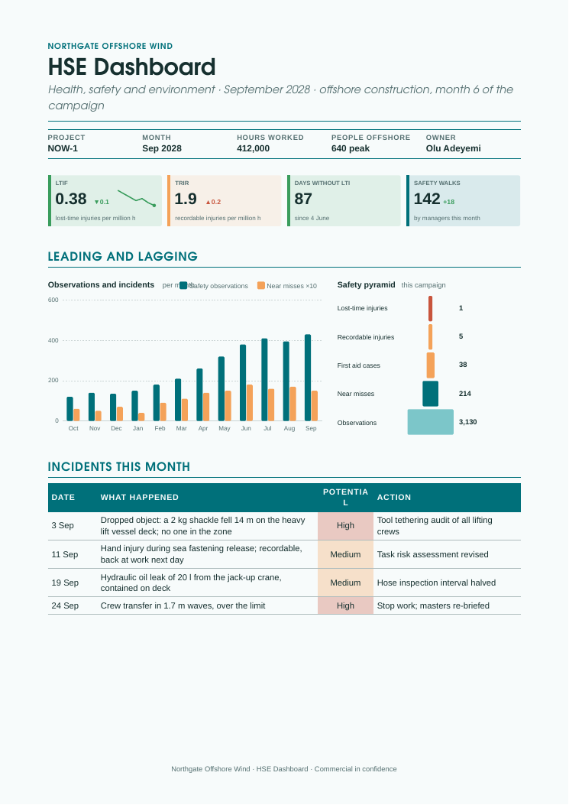

# libreoffice-scripts

Python scripts that write documents as flat OpenDocument XML, and a shell
script that converts them with LibreOffice into PDF, Word, images and about
thirty other formats. Each document is a self-contained project in
`scripts/`.

## Requirements

- LibreOffice, with `soffice` on the `PATH`
- Python 3, standard library only
- The fonts the projects use (Lato, Liberation, DejaVu, TeX Gyre, URW,
  Quicksand and others). LibreOffice substitutes missing fonts, but page
  counts may then change.

## Usage

```sh
./project.sh <project> <format>        # build one format
./project.sh <project> all             # build every format
./project.sh all <format>              # build every project
./project.sh <project> <format> clean  # remove one output
./project.sh <project> clean           # remove all outputs of a project
./project.sh clean                     # remove build/ and odf/
```

For example:

```sh
./project.sh job-hunting-nika-creative-technologist-cv-onepage pdf
./project.sh job-hunting-nika-creative-technologist-cv-onepage pdf clean
```

`<project>` is the name of a folder in `scripts/`, and the script can be
run from any directory. Outputs go to `build/<project>.<format>`, except
`docbook` and `wordxml` to `build/<project>.<format>.xml` and `odf` to
`odf/<project>.odt`. Existing outputs are skipped, so clean them to
rebuild. Without arguments, `./project.sh` prints the usage with every
format and the first ten projects; `ls scripts` lists them all.

### Formats

`apng bmp doc docbook docm docx dot dotx emf emz eps epub fodg fodt gif
html jpg odg otg ott pdf png rtf svg svgz tif txt uot webp wmf wmz wordxml
xhtml odf`

Documents convert best to Writer formats such as `pdf`, `odf`, `docx` and
`html`. Image and drawing formats such as `png`, `svg` and `odg` go through
LibreOffice Draw, which keeps only shapes placed on the page, so flowing
text comes out blank.

## How it works

```
project.sh ──> scripts/export<format>.py ──> scripts/common.py
                                               │ load_project()
                                               ▼
                         scripts/<project>/<name>.py: <name>() -> flat ODT
                                               │ export()
                                               ▼
                          soffice --headless --convert-to <format>
```

- `project.sh` checks the arguments and runs `scripts/export<format>.py`
  (or `scripts/saveodf.py`) with `PROJECT=<project>`.
- `scripts/common.py` imports the project, calls its function and runs
  LibreOffice with a throwaway profile, so it never touches a running
  LibreOffice and conversions can run in parallel.
- Each `scripts/export<format>.py` sets the LibreOffice filter and its
  options for one format.

## Projects

A project is a folder `scripts/<name>-<length>/`, where `<length>` is
`onepage`, `twopages` or `fourpages`:

```
scripts/job-hunting-nika-creative-technologist-cv-onepage/
├── onepage.py       # DESIGN and onepage(), which returns the flat ODT
├── content.py       # the subject and the DOCUMENT: everything it could say
└── typesetting.py   # turns content and design into exactly N pages
```

The last part of the folder name is the module and function name, so it
must be a valid Python name. A project needs nothing outside its folder.

**Exact page counts.** Fonts are never shrunk to fit. Every paragraph,
entry, table row and chart in `content.py` has a priority, and the
typesetter keeps the most important ones that fit, in document order. It
estimates line wrapping from each font's average character width; the
project management and accounting typesetters also simulate the page
breaks. The one, two and four page versions of a document share the same
content and design, cut to different lengths.

**Content.** `content.py` defines the subject (`PERSONA`, `PROJECT` or
`BUSINESS`) and the `DOCUMENT`: a title and sections. Each section has a
`kind` and priorities:

- `weight`: priority of its first item (lower is more important)
- `step`: how much less important each following item is
- `inner`: the same, for the lines inside an entry
- `min_pages` / `max_pages`: the lengths the section appears in

`**bold**` and `*italic*` work in all text.

**Design.** The `DESIGN` dict sets colors, fonts, density, margins and the
style of the header and headings, and where they exist, the orientation,
tables and charts. See `stylesheet()` (and `Theme`) in `typesetting.py`
for every option.

There are three families of projects, each with ten subjects in three
lengths.

### Accounting

Financial documents of fictional businesses, named
`accounting-<business>-<type>-<document>-<length>`. Each business has a
statement, a transactional document, a form or return, a register or
schedule, and an analysis, and every document has its own design.

| Business | Type | Documents |
|---|---|---|
| atelier-nord-architects | architecture-studio | client-invoice, staff-expense-claim, work-in-progress-schedule, utilisation-report, partner-capital-account-statement |
| bright-smile-dental | dental-practice | monthly-management-accounts, payslip, bank-reconciliation, accounts-receivable-aging, revenue-by-treatment-analysis |
| copperline-bicycle-works | bicycle-manufacturing | manufacturing-account, sales-order-confirmation, year-end-close-checklist, product-cost-sheet, capital-investment-appraisal |
| hollow-oak-winery | wine-estate | balance-sheet, purchase-order, excise-duty-return, fixed-asset-register, harvest-cost-allocation |
| lumen-analytics-saas | software-subscription | cash-flow-statement, order-form, rd-tax-credit-claim, cap-table, burn-and-runway-report |
| northbound-freight-haulage | road-haulage | trial-balance, remittance-advice, fuel-card-reconciliation, loan-amortisation-schedule, cost-per-mile-report |
| open-shelf-library-trust | community-charity | statement-of-financial-activities, gift-aid-claim, restricted-funds-register, grant-expenditure-report, donor-receipt |
| rye-and-crumb-bakery | artisan-bakery | profit-and-loss-statement, wholesale-invoice, daily-till-reconciliation, thirteen-week-cash-flow-forecast, break-even-analysis |
| salt-and-pine-hotel | boutique-hotel | departmental-profit-and-loss, guest-folio, night-audit-report, annual-operating-budget, revpar-performance-report |
| tidewear-outdoor-apparel | ecommerce-brand | income-statement-by-channel, credit-note, vat-return, inventory-valuation-report, unit-economics-report |

Figures are computed in `content.py`, so statements add up and related
documents agree. The typesetter is the project management one (see below)
with additions for financial statements: row styles (`section`, `indent`,
`subtotal`, `total` with a double rule, `highlight`, `muted`), per-row
`min_pages` and `max_pages`, `whole` tables that are never split,
borderless tables (`look: "plain"`) for addresses and signatures, and two
more charts: `sankey` for money flows and `gauges` for ratios.

### Job hunting

CVs, cover letters and portfolio pieces of fictional people in the digital
industries, named `job-hunting-<persona>-<job>-<document>-<length>`. Each
persona has a look of its own, from Swiss brutalist to till receipt.

| Persona | Job | Documents |
|---|---|---|
| felix | information-designer | cv, cover-letter, process-book |
| ines | ui-artist | cv, cover-letter, devlog |
| kai | visualisation-artist | cv, cover-letter, showreel-breakdown |
| leo | junior-frontend-developer | cv, cover-letter, learning-log |
| maks | xr-lead | cv, cover-letter, prototype-log |
| nika | creative-technologist | cv, cover-letter, code-sketchbook |
| otto | principal-engineer | cv, cover-letter, open-source-portfolio |
| ruth | art-director | cv, cover-letter, artist-statement |
| yuki | sound-designer | cv, cover-letter, sound-portfolio |
| zara | medical-animator | cv, cover-letter, animation-treatment |

Section kinds: `text`, `entries`, `bullets`, `tags` and `motto`.

### Project management

Plans, reports and registers of fictional projects, named
`project-management-<project>-<category>-<document>-<length>`. Schedules
such as the run of show and the cutover runbook are landscape.

| Project | Category | Documents |
|---|---|---|
| arctic-ice-cubesat-mission | aerospace-engineering | work-breakdown-structure, requirements-verification-matrix, mass-power-budget, launch-campaign-plan, risk-burndown-report |
| deep-sea-museum-exhibition | cultural-exhibition | creative-brief, object-loan-tracker, design-review-minutes, installation-schedule, visitor-evaluation-report |
| harbour-bridge-retrofit | civil-infrastructure | project-charter, earned-value-report, risk-register, three-week-lookahead, change-order-log |
| headquarters-relocation | workplace-change | move-schedule, stack-plan, change-impact-assessment, vendor-evaluation-matrix, communication-plan |
| hospital-ehr-migration | healthcare-it | cutover-runbook, go-live-readiness, training-plan, data-migration-report, raci-matrix |
| lighthouse-indie-game-launch | game-development | milestone-plan, playtest-report, bug-triage-report, launch-marketing-calendar, postmortem |
| mobile-banking-app-relaunch | agile-software | product-roadmap, sprint-review, release-plan, retrospective, okr-scorecard |
| offshore-wind-farm | renewable-energy | business-case, stage-gate-review, consent-tracker, weather-window-plan, hse-dashboard |
| summer-music-festival | event-production | run-of-show, production-budget, crew-roster, ticket-sales-dashboard, post-event-report |
| vaccine-cold-chain-rollout | public-health-ngo | logical-framework, donor-progress-report, monitoring-evaluation-plan, situation-report, procurement-plan |

These projects add `table`, `figure` and `callout` sections. A figure is
one or more charts side by side, drawn as SVG so they stay sharp in every
format: `gantt`, `line`, `bars`, `donut`, `risk`, `heatmap`, `kpis`,
`timeline`, `waterfall`, `quadrant`, `progress`, `board`, `tree`, `funnel`
and `chevrons`. Table cells can be colored by `badges`, such as RAG status
or RACI letters. A figure's `height` can depend on the length, e.g.
`{1: 150, 2: 170, 4: 190}`.

## Tests

```sh
bash tests/test_project.sh             # project.sh
python3 -m unittest discover tests     # the Python scripts
```

The tests need only bash and Python's standard library, and none of them
runs the application or writes outputs. `tests/test_project.sh` checks
that `project.sh` rejects bad arguments with its usage and exit code 1.
`tests/test_common.py` checks that `filter_data()` gives each filter
setting the type LibreOffice expects, including booleans, which Python
also counts as integers. `tests/test_pages.py` checks that every project
fills the number of pages its name promises, by its typesetter's own
estimate; it takes about fifteen seconds and needs no LibreOffice, so a
PDF can still differ when the estimate is wrong.

To lint the code with [ShellCheck](https://www.shellcheck.net/) and
[Ruff](https://docs.astral.sh/ruff/):

```sh
shellcheck project.sh tests/*.sh
ruff check .
```

GitHub Actions runs both, and the tests, on every push and pull request,
see [.github/workflows/ci.yml](.github/workflows/ci.yml).

## Gallery

`project-management-offshore-wind-farm-renewable-energy-hse-dashboard-onepage`,
exported with:

```sh
./project.sh project-management-offshore-wind-farm-renewable-energy-hse-dashboard-onepage pdf
```

Click the page to open the PDF:

[](gallery/project-management-offshore-wind-farm-renewable-energy-hse-dashboard-onepage.pdf)

## License

The scripts are licensed under the MIT license, see [LICENSE](LICENSE).
The files in `gallery/` were made with them and are under the same
license. The businesses, people and projects in the documents are
fictional.

The scripts drive software and use fonts that are not part of this
repository and have licenses of their own:

- [LibreOffice](https://www.libreoffice.org/about-us/licenses/) is free
  software under the Mozilla Public License, version 2.0, with parts
  also available under the GNU LGPL, version 3 or later. The scripts only
  run it as a separate program. Documents you convert with LibreOffice
  are yours, and its license does not apply to them.
- The fonts are free fonts, mostly under the SIL Open Font License
  (Lato, Liberation, Quicksand), the GUST Font License (TeX Gyre), the
  Bitstream Vera license (DejaVu) and the GNU AGPL with a font exception
  (URW base 35). All of them allow embedding subsets in PDFs and other
  documents, as LibreOffice does.
