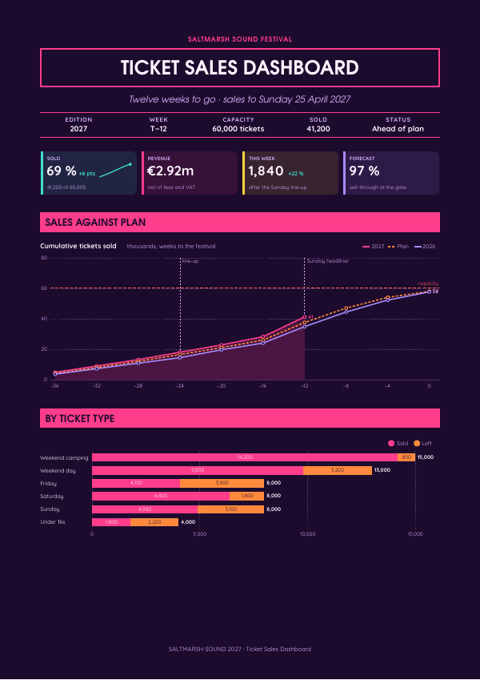
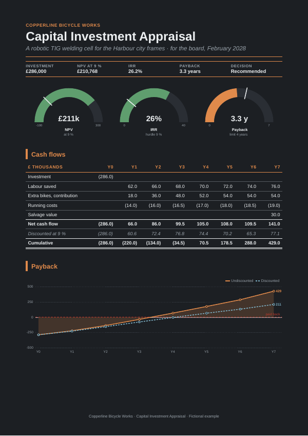
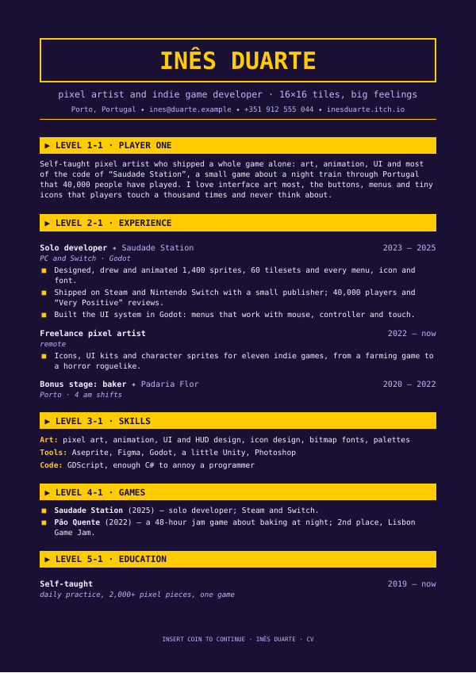
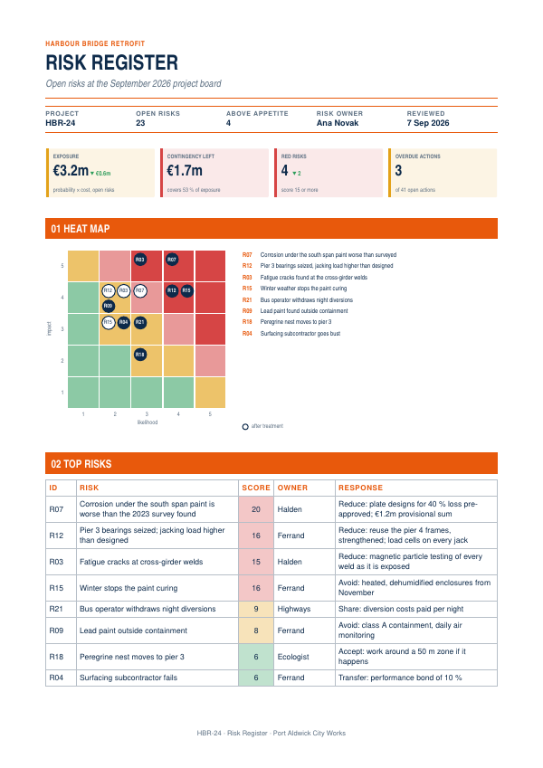
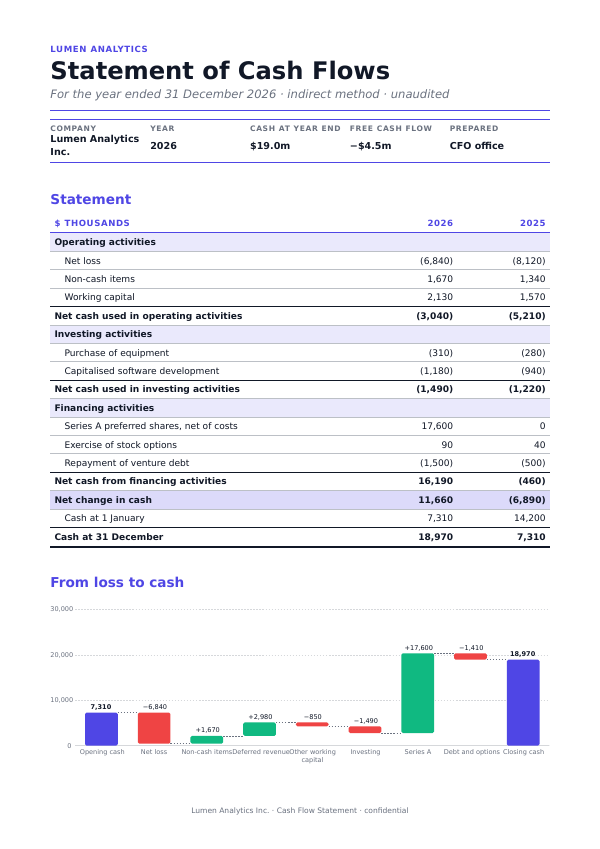
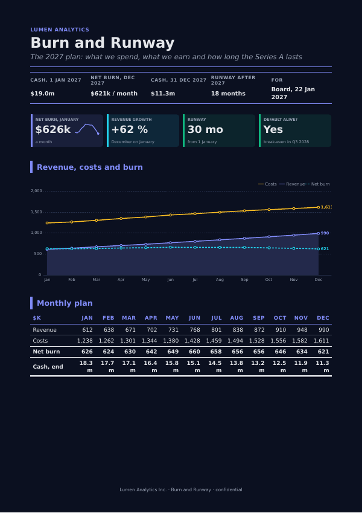
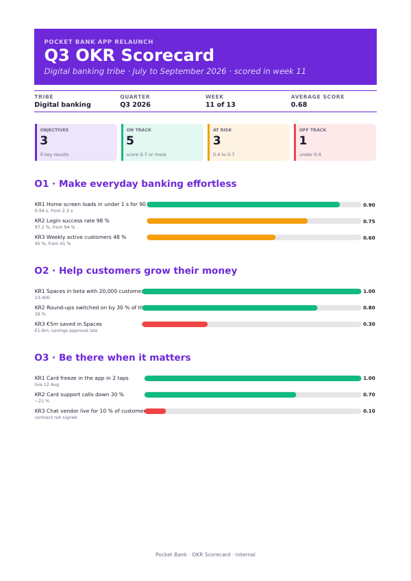
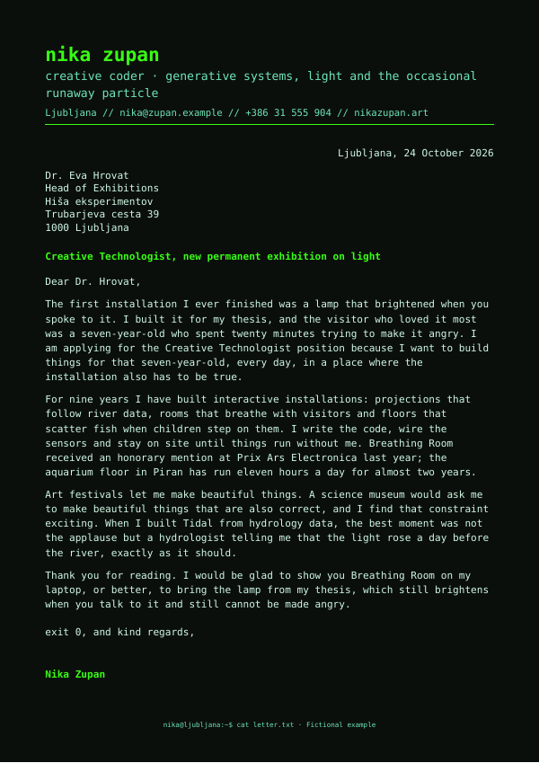
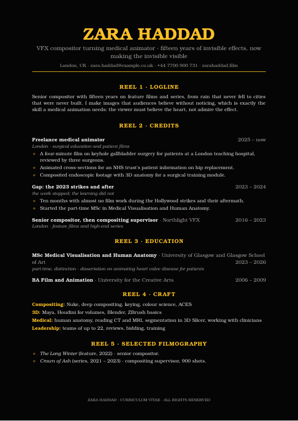

# libreoffice-scripts

[](https://github.com/aljazmc/libreoffice-scripts/actions/workflows/ci.yml)
[](LICENSE)
[](https://www.python.org/)
[](https://www.libreoffice.org/)
[](https://docs.oasis-open.org/office/OpenDocument/v1.3/)
[](https://github.com/astral-sh/ruff)
[](https://www.shellcheck.net/)
[](https://www.conventionalcommits.org/)

Documents written as code. Python scripts compose invoices, dashboards,
CVs and project plans as flat OpenDocument XML, and LibreOffice converts
them, without a window, to PDF, Word, images and 30 other formats. Every
document fills exactly the number of pages its name promises: one, two or
four.

<p align="center">
  <a href="gallery/project-management-summer-music-festival-event-production-ticket-sales-dashboard-onepage.pdf"></a>
  <a href="gallery/accounting-copperline-bicycle-works-bicycle-manufacturing-capital-investment-appraisal-onepage.pdf"></a>
  <a href="gallery/job-hunting-ines-ui-artist-cv-onepage.pdf"></a>
</p>

## Features

- **390 example projects** in three families, accounting, job hunting and
  project management, each with a design of its own.
- **Exact page counts.** Fonts are never shrunk to fit: content has
  priorities, and a typesetter keeps the most important part that fits
  one, two or four pages.
- **Charts as vector graphics:** gantt, waterfall, sankey, risk heat map,
  gauges, funnel and eleven more, drawn as SVG, so they stay sharp in
  every format.
- **34 output formats**, from `pdf`, `docx` and `odf` to `epub`, `html`,
  `svg` and `png`.
- **Standard library only.** No Python packages, nothing to install but
  LibreOffice and the fonts.
- **Safe to run in parallel.** Every conversion uses a throwaway
  LibreOffice profile and never touches a running LibreOffice.

## Gallery

Ten of the one-page documents. Click a page to open its PDF.

<p align="center">
  <a href="gallery/project-management-offshore-wind-farm-renewable-energy-hse-dashboard-onepage.pdf"></a>
  <a href="gallery/project-management-summer-music-festival-event-production-ticket-sales-dashboard-onepage.pdf"></a>
  <br><sub><b>HSE dashboard</b> · offshore wind farm &nbsp;&nbsp;|&nbsp;&nbsp; <b>Ticket sales dashboard</b> · music festival</sub>
</p>
<p align="center">
  <a href="gallery/project-management-harbour-bridge-retrofit-civil-infrastructure-risk-register-onepage.pdf"></a>
  <a href="gallery/accounting-copperline-bicycle-works-bicycle-manufacturing-capital-investment-appraisal-onepage.pdf"></a>
  <br><sub><b>Risk register</b> · bridge retrofit &nbsp;&nbsp;|&nbsp;&nbsp; <b>Capital investment appraisal</b> · bicycle maker</sub>
</p>
<p align="center">
  <a href="gallery/accounting-lumen-analytics-saas-software-subscription-cash-flow-statement-onepage.pdf"></a>
  <a href="gallery/accounting-lumen-analytics-saas-software-subscription-burn-and-runway-report-onepage.pdf"></a>
  <br><sub><b>Statement of cash flows</b> · SaaS company &nbsp;&nbsp;|&nbsp;&nbsp; <b>Burn and runway</b> · SaaS company</sub>
</p>
<p align="center">
  <a href="gallery/project-management-mobile-banking-app-relaunch-agile-software-okr-scorecard-onepage.pdf"></a>
  <a href="gallery/job-hunting-nika-creative-technologist-cover-letter-onepage.pdf"></a>
  <br><sub><b>OKR scorecard</b> · banking app &nbsp;&nbsp;|&nbsp;&nbsp; <b>Cover letter</b> · creative technologist</sub>
</p>
<p align="center">
  <a href="gallery/job-hunting-ines-ui-artist-cv-onepage.pdf"></a>
  <a href="gallery/job-hunting-zara-medical-animator-cv-onepage.pdf"></a>
  <br><sub><b>CV</b> · pixel artist &nbsp;&nbsp;|&nbsp;&nbsp; <b>CV</b> · medical animator</sub>
</p>

## Quick start

```sh
git clone https://github.com/aljazmc/libreoffice-scripts.git
cd libreoffice-scripts
./project.sh job-hunting-nika-creative-technologist-cv-onepage pdf
```

The PDF is written to `build/job-hunting-nika-creative-technologist-cv-onepage.pdf`.

## Requirements

| Requirement | Notes |
| --- | --- |
| LibreOffice | `soffice` on the `PATH`; it runs headless |
| Python 3 | standard library only |
| Fonts | Lato, Liberation, DejaVu, TeX Gyre, URW base 35, Quicksand, Noto Sans Mono and Tuffy. LibreOffice substitutes missing fonts, but page counts then change; `tests/test_fonts.py` finds them. |

## Usage

```sh
./project.sh <project> <format>        # build one format
./project.sh <project> all             # build every format
./project.sh all <format>              # build every project
./project.sh <project> <format> clean  # remove one output
./project.sh <project> clean           # remove all outputs of a project
./project.sh clean                     # remove build/ and odf/
```

`<project>` is the name of a folder in `scripts/`, and the script can be
run from any directory. Outputs go to `build/<project>.<format>`, except
`docbook` and `wordxml`, which go to `build/<project>.<format>.xml`, and
`odf`, which goes to `odf/<project>.odt`. Existing outputs are skipped, so
clean them to rebuild. Without arguments, `./project.sh` prints the usage
with every format and the first ten projects; `ls scripts` lists them all.

### Formats

| Kind | Formats |
| --- | --- |
| Documents | `pdf` `odf` `fodt` `ott` `uot` `docx` `docm` `dotx` `doc` `dot` `rtf` `wordxml` `docbook` |
| Web and e-books | `html` `xhtml` `epub` `txt` |
| Images | `png` `apng` `jpg` `gif` `bmp` `tif` `webp` |
| Drawings | `svg` `svgz` `odg` `otg` `fodg` `eps` `emf` `emz` `wmf` `wmz` |

Documents convert best to Writer formats such as `pdf`, `odf`, `docx` and
`html`. Image and drawing formats go through LibreOffice Draw, which keeps
only shapes placed on the page, so flowing text comes out blank.

## How it works

```
project.sh ──> scripts/export<format>.py ──> scripts/common.py
                                               │ load_project()
                                               ▼
                         scripts/<project>/<name>.py: <name>() -> flat ODT
                                               │ export()
                                               ▼
                          soffice --headless --convert-to <format>
```

- `project.sh` checks the arguments and runs `scripts/export<format>.py`
  (or `scripts/saveodf.py`) with `PROJECT=<project>`.
- `scripts/typesetting/` holds the typesetters the projects share, one per
  family: `accounting.py`, `job_hunting.py` and `project_management.py`.
  Accounting and project management both use `report.py`; the project
  management one passes it the few settings that keep its documents
  looking as they did. `job_hunting.py` takes only the shared XML and text
  helpers from `report.py`.
- `scripts/common.py` imports the project, calls its function and runs
  LibreOffice with a throwaway profile.
- Each `scripts/export<format>.py` sets the LibreOffice filter and its
  options for one format.

## Projects

A project is a folder `scripts/<name>-<length>/`, where `<length>` is
`onepage`, `twopages` or `fourpages`:

```
scripts/job-hunting-nika-creative-technologist-cv-onepage/
├── onepage.py       # DESIGN and onepage(), which returns the flat ODT
└── content.py       # the subject and the DOCUMENT: everything it could say
```

The last part of the folder name is the module and function name, so it
must be a valid Python name. A project needs nothing outside its folder but
the typesetter of its family: `onepage.py` starts with
`from typesetting.job_hunting import typeset`.

**Exact page counts.** Every paragraph, entry, table row and chart in
`content.py` has a priority, and the typesetter keeps the most important
ones that fit, in document order. It estimates line wrapping from each
font's average character width; the project management and accounting
typesetters also simulate the page breaks. The one, two and four page
versions of a document share the same content and design, cut to
different lengths.

**Content.** `content.py` defines the subject (`PERSONA`, `PROJECT` or
`BUSINESS`) and the `DOCUMENT`: a title and sections. Each section has a
`kind` and priorities:

| Key | Meaning |
| --- | --- |
| `weight` | priority of its first item (lower is more important) |
| `step` | how much less important each following item is |
| `inner` | the same, for the lines inside an entry |
| `min_pages`, `max_pages` | the lengths the section appears in |

`**bold**` and `*italic*` work in all text.

**Design.** The `DESIGN` dict sets colours, fonts, density, margins and the
style of the header and headings, and where they exist, the orientation,
tables and charts. See `stylesheet()` and `Theme` in
`scripts/typesetting/report.py`, or `job_hunting.py` for job hunting, for
every option.

There are three families of projects, each with ten subjects in three
lengths.

### Accounting

Financial documents of fictional businesses, named
`accounting-<business>-<type>-<document>-<length>`. Each business has a
statement, a transactional document, a form or return, a register or
schedule, and an analysis, and every document has its own design. Figures
are computed in `content.py`, so statements add up and related documents
agree.

<details>
<summary>10 businesses, 50 documents</summary>

| Business | Type | Documents |
| --- | --- | --- |
| atelier-nord-architects | architecture-studio | client-invoice, staff-expense-claim, work-in-progress-schedule, utilisation-report, partner-capital-account-statement |
| bright-smile-dental | dental-practice | monthly-management-accounts, payslip, bank-reconciliation, accounts-receivable-aging, revenue-by-treatment-analysis |
| copperline-bicycle-works | bicycle-manufacturing | manufacturing-account, sales-order-confirmation, year-end-close-checklist, product-cost-sheet, capital-investment-appraisal |
| hollow-oak-winery | wine-estate | balance-sheet, purchase-order, excise-duty-return, fixed-asset-register, harvest-cost-allocation |
| lumen-analytics-saas | software-subscription | cash-flow-statement, order-form, rd-tax-credit-claim, cap-table, burn-and-runway-report |
| northbound-freight-haulage | road-haulage | trial-balance, remittance-advice, fuel-card-reconciliation, loan-amortisation-schedule, cost-per-mile-report |
| open-shelf-library-trust | community-charity | statement-of-financial-activities, gift-aid-claim, restricted-funds-register, grant-expenditure-report, donor-receipt |
| rye-and-crumb-bakery | artisan-bakery | profit-and-loss-statement, wholesale-invoice, daily-till-reconciliation, thirteen-week-cash-flow-forecast, break-even-analysis |
| salt-and-pine-hotel | boutique-hotel | departmental-profit-and-loss, guest-folio, night-audit-report, annual-operating-budget, revpar-performance-report |
| tidewear-outdoor-apparel | ecommerce-brand | income-statement-by-channel, credit-note, vat-return, inventory-valuation-report, unit-economics-report |

</details>

The typesetter is the project management one (see below), with additions
for financial statements: row styles (`section`, `indent`, `subtotal`,
`total` with a double rule, `highlight`, `muted`), per-row `min_pages` and
`max_pages`, `whole` tables that are never split, borderless tables
(`look: "plain"`) for addresses and signatures, and two more charts:
`sankey` for money flows and `gauges` for ratios.

### Job hunting

CVs, cover letters and portfolio pieces of fictional people in the digital
industries, named `job-hunting-<persona>-<job>-<document>-<length>`. Each
persona has a look of its own, from Swiss brutalist to till receipt.

<details>
<summary>10 personas, 30 documents</summary>

| Persona | Job | Documents |
| --- | --- | --- |
| felix | information-designer | cv, cover-letter, process-book |
| ines | ui-artist | cv, cover-letter, devlog |
| kai | visualisation-artist | cv, cover-letter, showreel-breakdown |
| leo | junior-frontend-developer | cv, cover-letter, learning-log |
| maks | xr-lead | cv, cover-letter, prototype-log |
| nika | creative-technologist | cv, cover-letter, code-sketchbook |
| otto | principal-engineer | cv, cover-letter, open-source-portfolio |
| ruth | art-director | cv, cover-letter, artist-statement |
| yuki | sound-designer | cv, cover-letter, sound-portfolio |
| zara | medical-animator | cv, cover-letter, animation-treatment |

</details>

Section kinds: `text`, `entries`, `bullets`, `tags` and `motto`.

### Project management

Plans, reports and registers of fictional projects, named
`project-management-<project>-<category>-<document>-<length>`. Schedules
such as the run of show and the cutover runbook are landscape.

<details>
<summary>10 projects, 50 documents</summary>

| Project | Category | Documents |
| --- | --- | --- |
| arctic-ice-cubesat-mission | aerospace-engineering | work-breakdown-structure, requirements-verification-matrix, mass-power-budget, launch-campaign-plan, risk-burndown-report |
| deep-sea-museum-exhibition | cultural-exhibition | creative-brief, object-loan-tracker, design-review-minutes, installation-schedule, visitor-evaluation-report |
| harbour-bridge-retrofit | civil-infrastructure | project-charter, earned-value-report, risk-register, three-week-lookahead, change-order-log |
| headquarters-relocation | workplace-change | move-schedule, stack-plan, change-impact-assessment, vendor-evaluation-matrix, communication-plan |
| hospital-ehr-migration | healthcare-it | cutover-runbook, go-live-readiness, training-plan, data-migration-report, raci-matrix |
| lighthouse-indie-game-launch | game-development | milestone-plan, playtest-report, bug-triage-report, launch-marketing-calendar, postmortem |
| mobile-banking-app-relaunch | agile-software | product-roadmap, sprint-review, release-plan, retrospective, okr-scorecard |
| offshore-wind-farm | renewable-energy | business-case, stage-gate-review, consent-tracker, weather-window-plan, hse-dashboard |
| summer-music-festival | event-production | run-of-show, production-budget, crew-roster, ticket-sales-dashboard, post-event-report |
| vaccine-cold-chain-rollout | public-health-ngo | logical-framework, donor-progress-report, monitoring-evaluation-plan, situation-report, procurement-plan |

</details>

These projects add `table`, `figure` and `callout` sections. A figure is
one or more charts side by side: `gantt`, `line`, `bars`, `donut`, `risk`,
`heatmap`, `kpis`, `timeline`, `waterfall`, `quadrant`, `progress`,
`board`, `tree`, `funnel` and `chevrons`. Table cells can be coloured by
`badges`, such as RAG status or RACI letters. A figure's `height` can
depend on the length, e.g. `{1: 150, 2: 170, 4: 190}`.

## Tests

```sh
for test in tests/sh/test_*.sh; do bash "$test"; done            # project.sh
python3 -m unittest discover tests/py                            # all Python tests
python3 -m unittest discover tests/py -p test_pages.py -k cv-onepage  # the page tests of some projects
EXPORTS='job-hunting-*' python3 -m unittest discover tests/py -p test_exports.py
```

The tests are split by language: `tests/sh/` tests `project.sh` with bash,
`tests/py/` tests the Python scripts and the documents they typeset. Apart
from the export tests, they need only bash and Python's standard library,
and none of them writes outputs into the repository.

The tests of `project.sh` run it in a temporary sandbox, with a few fake
projects and stand-ins for `python3` and `soffice` (see `tests/sh/lib.sh`),
so they typeset nothing and never touch `build/` or `odf/`:

- `tests/sh/test_project.sh` checks that `project.sh` rejects bad arguments
  with its usage and exit code 1.
- `tests/sh/test_formats.sh` checks that the formats of `project.sh`, the
  exporters in `scripts/` and this README agree: every format has an
  exporter that writes its own file, every exporter is listed, the Formats
  table names every format and the count of formats is right, and exactly
  the image and drawing formats go through LibreOffice Draw.
- `tests/sh/test_outputs.sh` checks the names of the outputs, as described
  under Usage, through the `clean` commands, including the `.xml` of
  `docbook` and `wordxml` and the `.odt` of `odf`.
- `tests/sh/test_run.sh` checks that `project.sh` runs the right script
  with the project in `PROJECT` and `scripts/` first on the `PYTHONPATH`,
  for one project and for `all`, never for the shared typesetters, and from
  any directory; that it skips existing outputs, reports a failed export
  with exit code 1 and stops when `soffice` or `python3` is missing.

The Python tests build each project as `project.sh` does, in a separate
Python process (see `tests/py/documents.py`):

- `tests/py/test_common.py` checks that `filter_data()` gives each filter
  setting the type LibreOffice expects, including booleans, which Python
  also counts as integers.
- `tests/py/test_pages.py` gives every project two tests. The estimate test
  checks that the typesetter's own estimate fills exactly the pages the
  name promises; it needs no LibreOffice and takes a fraction of a second.
  The PDF test reads the page count of `build/<project>.pdf`, the document
  Writer really produced, and is skipped when the PDF is not built or is
  older than its scripts. Pick projects with `-k`, or only one kind with
  `-k estimate` or `-k test_pdf`.
- `tests/py/test_fonts.py` checks the fonts. The typesetters' width tables
  must agree and every font must have a license named in this README;
  every font a project's `DESIGN` names must have a width in its
  typesetter; every font must be installed; and every built PDF must embed
  the body and heading fonts of its design, not a replacement LibreOffice
  picked for a missing font. The last two use `fc-list` and `pdffonts`
  (poppler-utils), and are skipped where those, the PDF or, on CI, the
  fonts are missing.
- `tests/py/test_fiction.py` checks that the footer of every example project
  ends with "Fictional example", the notice printed on every page.
- `tests/py/test_document.py` reads every document's flat ODT without
  LibreOffice: a text document with a title (the PDF's title) and a
  language (its hyphenation, and what a screen reader speaks), every style,
  page layout and font it names defined (LibreOffice quietly replaces a
  missing one), an A4 or Letter page, either way up, whose margins leave
  room for the text, tables and charts no wider than the text, charts that
  are valid SVG inside the document, and the same document on every build.
- `tests/py/test_readability.py` follows every piece of text to its color,
  size and what it is printed on (the table cell, the paragraph or the
  page): its contrast must be at least 2:1, which catches text that can't
  be read at all (WCAG AA asks 4.5:1 for body text, which a third of the
  designs don't reach yet); it must be at least 6 pt; and no paragraph may
  hold an unfilled `{placeholder}`, an unformatted `None` or `nan`, or a
  `TODO` or lorem ipsum.
- `tests/py/test_exports.py` runs every export script on a temporary copy
  of `scripts/` and checks each file by what is inside it: the PDF has the
  pages the name promises, the Writer formats (`odf`, `docx`, `doc`, `rtf`,
  `html`, `epub`, `txt`...) keep the document's words and their document
  type, the images come out at the size their script asks for, and the
  drawings carry their format's signature. Every format needs a check of
  its own, so a new format can't go untested. It exports the projects shown
  in `gallery/`, or those `EXPORTS` names (a pattern, or `all`), in about
  15 seconds each, and needs `soffice` and Pillow, so CI skips it. `apng`
  is skipped for its size: LibreOffice's APNG filter ignores the size it
  is asked for.

Lint the code with [ShellCheck](https://www.shellcheck.net/) and
[Ruff](https://docs.astral.sh/ruff/):

```sh
shellcheck project.sh tests/sh/*.sh
ruff check .
```

GitHub Actions runs the linters and the tests on every push and pull
request, see [.github/workflows/ci.yml](.github/workflows/ci.yml).

## License

The scripts are licensed under the [MIT License](LICENSE). The files in
`gallery/` were made with them and are under the same license. The
businesses, people and projects in the documents are fictional, and the
footer of every page says so.

The scripts drive software and use fonts that are not part of this
repository and have licenses of their own:

- [LibreOffice](https://www.libreoffice.org/about-us/licenses/) is free
  software under the Mozilla Public License, version 2.0, with parts also
  available under the GNU LGPL, version 3 or later. The scripts only run it
  as a separate program. Documents you convert with LibreOffice are yours,
  and its license does not apply to them.
- The fonts are free fonts: the SIL Open Font License (Lato, Liberation,
  Quicksand, Noto Sans Mono), the GUST Font License (TeX Gyre), the
  Bitstream Vera license (DejaVu), the GNU AGPL with a font exception (URW
  base 35: C059, P052, Nimbus Sans, URW Gothic and URW Bookman) and the
  public domain (Tuffy). All of them allow embedding subsets in PDFs and
  other documents, as LibreOffice does.
